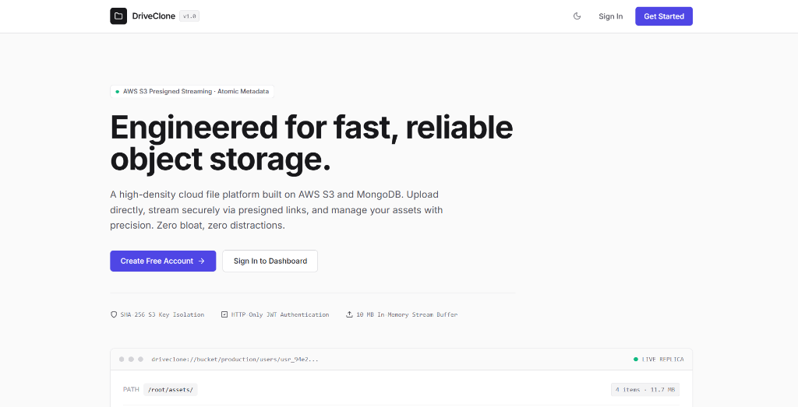

# DriveClone ⚡

> A high-density cloud file storage platform engineered for fast, reliable object management. Built on Node.js, AWS S3, and MongoDB with a modern, developer-centric interface.

[](https://nodejs.org/)
[](https://expressjs.com/)
[](https://aws.amazon.com/s3/)
[](https://www.mongodb.com/)
[](https://tailwindcss.com/)
[](LICENSE)

---

## 📌 Project Preview

<p align="center">
  
</p>

---

## 🚀 Overview

**DriveClone** is a minimalist, portfolio-grade cloud storage application designed for developers who value performance, simplicity, and clean data density over bloated SaaS tropes. 

Unlike traditional cloud drive clones that rely on Google Material design or heavy glassmorphism, DriveClone adopts a refined **Linear/Vercel-inspired aesthetic** with a tight typographic hierarchy, subtle borders, accessible contrast, and zero layout bloat.

### Architecture Highlights:
- **Direct S3 Presigned Streaming:** Downloads bypass application memory bottleneck by generating short-lived AWS S3 presigned URLs on the fly for secure, direct client retrieval.
- **In-Memory Upload Pipeline:** Incoming multipart streams are buffered temporarily in memory (up to 10 MB limit) and dispatched straight to private AWS S3 buckets.
- **Atomic Lifecycle Management:** File deletion operations synchronize S3 object removal with MongoDB document purging, ensuring zero orphan objects or dangling references.
- **Stateless Authentication:** User sessions are secured with signed JSON Web Tokens (JWT) sealed in HTTP-only, SameSite cookies alongside bcrypt credential hashing.

---

## ✨ Features

- 🔐 **Secure Authentication:** User registration and sign-in protected by bcrypt password hashing and HTTP-only JWT cookies.
- 🌓 **Persistent Dark & Light Mode:** Seamless theme switcher with anti-FOUT inline script, persistent `localStorage` synchronization, and OS-level `prefers-color-scheme` matching.
- 📤 **Drag-and-Drop Staging:** Reactive dashed dropzone that accepts multiple file uploads simultaneously with staging previews and individual file removal.
- 📊 **Minimalist Progress Tracker:** Subtle, non-intrusive progress bars that display active percentage and item count during batch uploads.
- 🗂️ **Data-Dense File Management:** Clean tabular view with contextual file-type icons (PDF, Code, Images, Archives, Media, Docs), exact byte formatting, and formatted upload timestamps.
- ⚡ **Instant Client-Side Filtering:** Real-time search filter input to quickly locate files by name or extension without making unnecessary network requests.
- 🗑️ **Custom Confirmation Modal:** Completely eliminated native browser `alert()` or `confirm()` dialogs in favor of an accessible, keyboard-aware destructive deletion modal.
- 📱 **Fully Responsive Layout:** Optimized data tables and navigational flows across mobile, tablet, and desktop viewports.

---

## 🛠️ Tech Stack

### Frontend
- **Templating:** [EJS](https://ejs.co/) (Embedded JavaScript templates)
- **Styling:** [Tailwind CSS](https://tailwindcss.com/) (Class-based dark mode, custom typography tokens)
- **Typography:** [Inter](https://fonts.google.com/specimen/Inter) font via Google Fonts
- **Interactions:** Vanilla JavaScript (ES6+ async/await, Fetch API, FormData, Drag & Drop API)

### Backend
- **Runtime:** [Node.js](https://nodejs.org/) (LTS)
- **Framework:** [Express.js v5](https://expressjs.com/)
- **Authentication:** [jsonwebtoken (JWT)](https://github.com/auth0/node-jsonwebtoken) & [bcrypt](https://github.com/kelektiv/node.bcrypt.js)
- **Multipart Uploads:** [Multer](https://github.com/expressjs/multer) (In-memory storage buffer)
- **Validation:** [express-validator](https://express-validator.github.io/docs/)

### Cloud & Database
- **Cloud Storage:** [AWS S3](https://aws.amazon.com/s3/) (AWS SDK for JavaScript v3 `@aws-sdk/client-s3`, `@aws-sdk/s3-request-presigner`)
- **Database:** [MongoDB](https://www.mongodb.com/) via [Mongoose](https://mongoosejs.com/) ORM

---

## 📁 Repository Structure

```text
DriveClone/
├── config/
│   └── db.js                 # MongoDB connection handler
├── middleware/
│   └── auth.middleware.js     # JWT cookie verification middleware
├── models/
│   ├── file.model.js         # Mongoose schema for file metadata
│   └── user.model.js         # Mongoose schema for user credentials
├── routes/
│   ├── file.routes.js        # File upload, download presigning, delete endpoints
│   ├── index.routes.js       # Authenticated dashboard render routes
│   └── user.routes.js        # Registration, login, and logout controllers
├── services/
│   └── s3.service.js         # AWS S3 Client & presigner abstraction service
├── views/
│   ├── home.ejs              # Authenticated file management dashboard
│   ├── index.ejs             # High-impact landing page with theme toggle
│   ├── login.ejs             # Minimalist sign-in card view
│   └── register.ejs          # Minimalist registration view
├── app.js                    # Express application entrypoint
├── package.json              # Dependencies and script definitions
├── tailwind.config.js        # Tailwind CSS configuration with darkMode: 'class'
└── .env                      # Environment variable definitions (ignored by git)
```

---

## ⚙️ Getting Started

### Prerequisites

Ensure you have the following installed on your local machine:
- [Node.js](https://nodejs.org/) (version 18.x or 20.x+)
- [MongoDB](https://www.mongodb.com/) (running locally or a free [MongoDB Atlas](https://www.mongodb.com/atlas) cluster)
- An active [AWS Account](https://aws.amazon.com/) with an S3 Bucket and IAM credentials

### 1. Clone the Repository

```bash
git clone https://github.com/SyedUzaiir/DriveClone.git
cd DriveClone
```

### 2. Install Dependencies

```bash
npm install
```

### 3. Environment Variables Configuration

Create a `.env` file in the root directory:

```bash
# On Linux/macOS:
touch .env

# On Windows PowerShell:
New-Item .env
```

Populate `.env` with your credentials:

```ini
# Server Configuration
PORT=3000
NODE_ENV=development

# Database Connection
MONGO_URI=mongodb://127.0.0.1:27017/driveclone

# Security & Sessions
JWT_SECRET=your_super_secret_jwt_key_change_in_production

# Amazon Web Services (AWS) S3
AWS_REGION=us-east-1
AWS_BUCKET_NAME=your-private-s3-bucket-name
AWS_ACCESS_KEY_ID=your_aws_iam_access_key_id
AWS_SECRET_ACCESS_KEY=your_aws_iam_secret_access_key
```

> **Security Note:** Never commit your actual `.env` file to version control. The repository includes `.gitignore` to protect sensitive secrets.

---

## 🚦 Running the Application

### Development Mode

Run the server with hot-reloading via `nodemon`:

```bash
npm start
```

### Production Mode

Run the server directly using Node:

```bash
node app.js
```

Once started, open your browser and navigate to:
```text
http://localhost:3000
```

---

## 🔒 Security Practices

1. **Private S3 Objects:** All uploaded files are stored privately in S3. Public read access to the bucket is blocked.
2. **Short-Lived URLs:** Download URLs are signed using AWS SigV4 and expire after 1 hour (3600 seconds).
3. **No Password Leakage:** Passwords are salted and hashed with 10 rounds of `bcrypt`. Model queries explicitly omit password hashes from responses.
4. **Cookie Protection:** JWT tokens are transferred exclusively via `HttpOnly`, `SameSite=Lax` cookies, shielding authentication state from Cross-Site Scripting (XSS).

---

## 📄 License

This project is open-source and available under the [MIT License](LICENSE).

---

## 👨‍💻 Author & Contact

**Syed Uzair Mohiuddin**

- **GitHub:** [@SyedUzaiir](https://github.com/SyedUzaiir)
- **Repository:** [https://github.com/SyedUzaiir/DriveClone](https://github.com/SyedUzaiir/DriveClone)

If you find this project useful or appreciate the design system, feel free to give the repository a ⭐!
